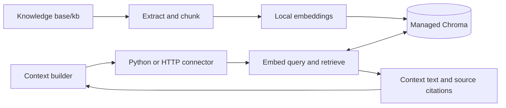

# Local knowledge-folder RAG

Place documents in `Knowledge base/kb/`. The system extracts text, splits it into overlapping token chunks, embeds it locally, and stores vectors in a persistent Chroma database. A context builder retrieves relevant passages through Python or HTTP. Answer generation belongs to the context builder; this service supplies the retrieved evidence.



## Setup

Requires Python 3.10+ and internet access for installation and the first model download. From this `RAG` folder:

```powershell
python scripts/setup.py
```

Or use `./setup.ps1`. The script creates `.venv`, installs dependencies, creates the folder and database, and downloads the embedding model into `.rag/models`. No Docker, Chroma service, cloud account, or API key is required. To defer the model download, pass `--skip-model`. Subsequent retrieval runs locally using the cached model.

Place your documents under `Knowledge base/kb/`, including subfolders, then start:

```powershell
.\.venv\Scripts\python.exe -m rag serve
```

The server indexes on startup and scans for changes every five seconds. HTTP listens on `127.0.0.1:8000`; interactive API docs are at `http://127.0.0.1:8000/docs`. Set `--watch-interval 0` to disable polling. Keep the default single server process for this embedded store; connect other applications over HTTP.

On macOS/Linux, replace `.\.venv\Scripts\python.exe` with `.venv/bin/python`.

For explicit indexing and command-line queries:

```powershell
.\.venv\Scripts\python.exe -m rag sync
.\.venv\Scripts\python.exe -m rag query "What is our onboarding process?" --top-k 5
.\.venv\Scripts\python.exe -m rag status
```

`sync` returns an indexing report and a nonzero exit code if any file failed. Unsupported files appear under `skipped`. The API reports per-file failures in the response to `/sync` and in `/status`.

## Context-builder connectors

When the builder runs in the same Python application:

```python
from rag import RAGService
from rag.connectors import LocalConnector

service = RAGService()
report = service.sync()  # Call again when documents change.
connector = LocalConnector(service)
result = connector.retrieve("What is our onboarding process?", top_k=5, max_chars=12000)

context = result.context  # Citation labels and retrieved passages.
sources = result.matches  # Structured source, page, chunk, distance, and text.
```

When the RAG server runs separately:

```python
from rag.connectors import HTTPConnector

connector = HTTPConnector("http://127.0.0.1:8000")
result = connector.retrieve("What is our onboarding process?", top_k=5)
```

Both connectors implement `ContextConnector.retrieve(...)` and return the same `QueryResponse`. Because no context-builder project or schema was provided, these are reusable integration points; your builder can consume `result.context` and retain `result.matches` for citations.

Any language can use the HTTP API:

```javascript
const response = await fetch("http://127.0.0.1:8000/query", {
  method: "POST",
  headers: { "Content-Type": "application/json" },
  body: JSON.stringify({ query: "What is our onboarding process?", top_k: 5, max_chars: 12000 }),
});
if (!response.ok) throw new Error(await response.text());
const { context, matches } = await response.json();
```

| Endpoint | Purpose |
| --- | --- |
| `GET /health` | Liveness |
| `GET /status` | Index counts, paths, and latest sync report |
| `POST /sync` | Synchronize the knowledge folder immediately |
| `POST /query` | Retrieve context and source matches |

Query fields: `query` (required), `top_k` (1–100, default 5), `max_chars` (1–100000, default 12000), and optional `source` (exact path relative to the knowledge folder, with `/` separators). `max_chars` caps the complete context including citation headers; a final passage may be truncated and is marked accordingly. If the budget cannot fit a header plus text, no match is included. Distances are cosine distances: smaller means closer, and they are not confidence probabilities. An empty index or an unmatched source filter returns empty context and matches. Queries over 254 model tokens are rejected explicitly.

## Files and persistence

```text
RAG/
  Knowledge base/kb/        # Your documents, recursively discovered
  .rag/
    chroma/                # Persistent vectors, extracted chunks and metadata
    models/                # Local embedding model cache
    knowledge_base.manifest.json
  src/rag/                 # Pipeline, CLI, API, connectors
  scripts/setup.py         # Automated setup
  examples/context_builder.py
  tests/
```

Supported inputs: UTF-8 `.txt`, `.md`, `.markdown`, `.json`, `.csv`, `.html`, `.htm`, text PDFs, and `.docx` (paragraphs and tables). PDF results retain page numbers. Scanned PDFs require OCR; encrypted PDFs, images, audio/video, legacy `.doc`, and spreadsheets are not supported in this version. HTML scripts/styles are excluded. DOCX headers, footers, and embedded objects are not extracted.

Unchanged files are skipped using a hash of the bytes and pipeline settings. Changed files become a new revision, and removed files are pruned. A revision is published only after all chunks have been stored; queries filter against the committed manifest, so incomplete batches never appear. A parse or embedding failure retains the last successful version. Old and abandoned revisions are cleaned up during sync. File locks serialize sync/query access, and manifest replacement is atomic. If the knowledge folder becomes unavailable, sync fails without pruning the previous index.

Do not remove or move an indexed document unless you want its vectors removed on the next sync. Back up the whole `.rag` directory together if retaining an index snapshot. The original documents remain the source of truth and can rebuild the index. Source documents and `.rag` are ignored by Git by default.

## Configuration

Defaults are anchored to the project path, even if a connector is called from another working directory. Environment overrides:

| Variable | Default |
| --- | --- |
| `RAG_ROOT` | This project directory |
| `RAG_KB_DIR` | `Knowledge base/kb` relative to root |
| `RAG_DATA_DIR` | `.rag` relative to root |
| `RAG_COLLECTION` | `knowledge_base` |
| `RAG_CHUNK_TOKENS` | `220` |
| `RAG_OVERLAP_TOKENS` | `32` |

Absolute directory overrides also work. The data directory must be outside the knowledge folder. Changing chunk settings causes reindexing on the next sync. Use a new collection when switching knowledge roots or embedding models. The initial embedding model is `all-MiniLM-L6-v2` on CPU; `RAGService(..., embedder=...)` supports a replacement that implements `Embedder` and provides token offsets. Its limits and chunk settings must agree.

This is a local, single-user retrieval component. No authentication or multi-tenant isolation is included. Retrieved passages are document content; the context builder should treat them as evidence, not executable instructions. Retrieval always returns nearest passages when available, even when the question has no good answer; answerability checks and reranking are future work.

## Input validation later

No prescribed document hierarchy or content schema is enforced. Basic guards already skip unsupported extensions, hidden files/directories and symlinks, enforce a 50 MiB file limit, reject unreadable/empty input, and report failures separately for each file. This is not a sandbox for hostile documents.

A later validation layer should run **before extraction**, returning a report with `source`, `status`, `code`, and `message` for each input. Recommended additions:

1. Check file signatures against extensions, encoding, file size, PDF page counts, archive expansion limits, and parser timeouts.
2. Define optional sidecar metadata with a schema for document ID, title, owner, tags, access scope, and update timestamp. Keep the folder structure unrestricted unless the builder needs a hierarchy.
3. Quarantine corrupt, encrypted, unsupported, or suspicious files, offer OCR for scanned PDFs, and detect duplicates by checksum.
4. Validate extracted text quality and preserve provenance. Enforce access filters during retrieval before supporting multiple users.

## Verification

```powershell
python scripts/setup.py --dev --skip-model
.\.venv\Scripts\python.exe -m pytest -q
```

Tests use real persistent Chroma with deterministic test embeddings, so they require no model download. They cover retrieval, persistence, incremental edits/deletions, parse and embedding failures, incomplete revisions, context budgets, loaders, and Python/HTTP contract compatibility.

To check the actual local embedding model as well, run `.\.venv\Scripts\python.exe scripts/smoke_test.py`. This indexes `examples/sample_kb` into a separate `smoke_knowledge` collection under `.rag`; it does not add sample documents to your main knowledge folder.

Chroma references: [persistent client](https://docs.trychroma.com/reference/python/client), [local default embeddings](https://docs.trychroma.com/docs/embeddings/embedding-functions), and [collection operations](https://docs.trychroma.com/reference/python/collection).

